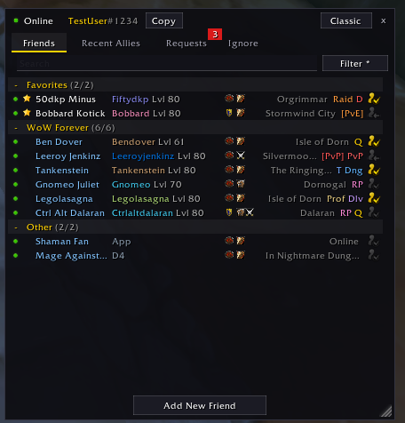
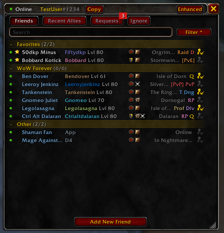

# Old Friends

**Old Friends** replaces the default friends window (the O key) with a fast list that shows one line per friend. Each row shows their status, faction, ruleset, name, character, level, location, and activity.

## Smart 1-click invites
Instead of offering an invite for every player on your faction, Old Friends only offers it for the ones you can actually invite.

## Everything the default window does, plus extras
Old Friends keeps the standard Blizzard social features and moves them into tabs and right-click menus.

*   Friends tab: All your B-Net, WoW, and legacy friends, with favorites, custom notes, custom tags, and queue badges that show who is sitting in a PvE, PvP, or group queue. Online WoW friends also show a faction emblem and a ruleset icon (PvE, PvP, RP, RP-PvP).
*   Recent Allies: View, pin, and invite recent players in one click.
*   Requests and Ignored: Manage your ignore list and accept or decline friend requests. The tab glows and shows a number badge when a new request comes in.
*   Search and filter: Search by name, B-Tag, character, zone, or custom notes. Filter the list by status (Online, Away, Busy, Offline, In Queue, Available for Queue).
*   Quick controls: Copy your own B-Tag from the top of the window, or add friends by B-Tag, email, or character.
*   Context menus: Right-click anyone to whisper, invite, set notes, customize names, report, or remove.
*   Shift+O (Shift plus whatever key you have bound to the friends window) opens Blizzard's default window if you need it.

## Two looks
On first open, you choose a style:
*   Enhanced: modern, flat, dark, and compact.
*   Classic: the traditional WoW style, with gold borders and red buttons.

You can switch anytime with the top bar button or `/of skin toggle`.

## Commands

| Command | What it does |
|---|---|
| `/of` (or `/oldfriends`) | Show/hide the window |
| `/of skin [classic\|enhanced\|toggle]` | Change the look |
| `/of scale <0.5-2>` | Adjust window size |
| `/of reset` | Reset position, scale, and filters |
| `/of test` | Test mode with fake friends, allies and requests |
| `/of log`, `/of log all`, `/of log clear` | View or clear the diagnostics log |
| `/of debug on\|off` | Echo logs to chat |

## Addon limitations
Blizzard restricts some social functions so addons can't automate them, which limits a few things here:
*   Your status: You can't set yourself to "Appear Offline" from this addon. Clicking Away or Busy here only sets your in-game AFK/DND flags.
*   Blocking B-Net accounts: Disabled here. Use the default Social window (Shift+O, or `/friends`) to block or unblock Battle.net accounts.
*   Adding by character: This goes through Blizzard's default popup.
*   Queue filters: The addon guesses from the queue data it is allowed to see, so the results may be off.
*   Faction and ruleset icons: Offline friends and legacy-list friends don't show them, because the game doesn't give that information for them.
*   Recent Allies: The game only loads this list when Blizzard's own Recent Allies view opens. Until then, Old Friends shows the last list it saw. The Load Recent Allies button opens Blizzard's view for a moment to load the live list.

Privacy note: Old Friends never sends or reads anything outside the game. Nothing is collected.

## Install
Copy these files into a folder named `OldFriends` inside your `Interface/AddOns` directory.

## Feedback
Bug reports and ideas are welcome in the Issues tab. If you get a "blocked action" error, run `/of log` and paste the output into your report.

**License:** MIT | **Copyright:** 2026 Parker Tonra
